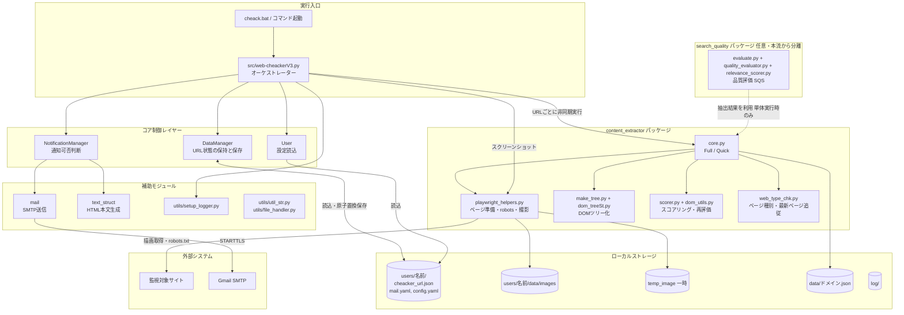

# 基本設計書（Web更新チェッカー 基本仕様・システム全体アーキテクチャ定義）
**Playwright によるメインコンテンツ検出と、リンク集合のハッシュ比較による更新検知**

---

## 1. 概要と基本方針

### 1.1 システム目的と対象範囲

監視対象Webページの「更新」を定期実行で検知し、更新があったページだけを利用者へメール通知する。ページ全体ではなく、ページ内で最も本文らしい領域（メインコンテンツ）を自動特定し、その領域のリンク集合が変化したかどうかで更新を判定する。広告・ナビゲーションなどの変動による誤検知を減らすことが主目的である。

- **対象範囲**: 次の機能を本書の対象とする。
  - 監視対象URLの一括スキャン（Fullスキャン、Quickスキャン）
  - 更新検知（リンク集合のSHA-256比較）
  - 更新ページのスクリーンショット取得（メール添付用、永続保存用）
  - 更新通知メールとエラー通知メールの送信
  - 検索結果ページの品質評価（SQS: Search Quality Score）。監視本流から分離した任意機能として `search_quality` パッケージに置く
  - Google検索結果の妥当性検証スクリプト（`search_quality/search_and_validate.py`。補助ツール）
- **対象外範囲**: 次は本書の対象外とする。
  - `cheacker_tool.html`（本システムの処理から参照されない独立HTML。別用途のため設計対象外）
  - `scripts/choice_content_experiment.py`（手動実行の実験コード。`pytest` にも収集されない）
  - 常駐実行・スケジューラ（定期起動はOSのタスク実行などに委ねる）
- **利用者・外部システム**:

| 区分         | 名称                         | 関わり方                                                                 |
| :----------- | :--------------------------- | :----------------------------------------------------------------------- |
| 利用者       | 運用者（本ツールの設定者）   | コマンド起動、ユーザープロファイルとURLリストの管理、通知の受信          |
| 外部システム | 監視対象Webサイト            | Chromium経由でページ取得。`robots.txt` を事前確認する                    |
| 外部システム | Gmail SMTPサーバー           | 通知メールの送信先（`smtp.gmail.com` ポート587、STARTTLS）               |
| 外部システム | Google検索（補助ツールのみ） | `search_quality/search_and_validate.py` が検索結果のURLを取得する        |
| 外部システム | Hugging Faceモデル配布元     | 品質評価の初回実行時に埋め込みモデルを取得する（`quality` 追加依存のみ） |

- **前提・制約**:
  - Python 3.10 以上。Windows での運用を主とし、`core.py` は Windows 上でイベントループポリシーを Proactor に設定する。
  - ブラウザは Chromium（Playwright）に限定する。
  - 通知手段はメールのみで、メールアカウントは Gmail を前提とする。
  - 永続データはローカルファイルのみで、データベースは使わない。
  - 本書は現行実装の挙動を記述する。
- **主要な非機能要件**: 値は現行実装の設定・定数から読み取った現状値であり、正式な合意値ではない。

| ID      | 区分         | 要件                                           | 目標値・基準（現行実装値）                                                                                           | 測定方法・確認先                  | 正本                                                               |
| :------ | :----------- | :--------------------------------------------- | :------------------------------------------------------------------------------------------------------------------- | :-------------------------------- | :----------------------------------------------------------------- |
| NFR-001 | 可用性       | 1URLの失敗で他URLの監視を止めない              | `process_url_async` の最上位で例外を記録して継続する                                                                 | 単体テスト、ログ確認              | [ADR-002](../adr/ADR-002_exception-handling-policy.md)、WCM-DD-001 |
| NFR-002 | 性能         | 同時スキャン数を設定で制御できる               | 既定2（`scan.worker_threads`）。ブラウザは1回の実行で1つ                                                             | 実行ログ                          | WCM-DD-001                                                         |
| NFR-003 | 性能         | URLごとの処理時間を監視する                    | 既定60秒（`scan.timeout_per_url`）。超過は強制中断せず、エラー一覧へ記録する                                         | エラー通知、ログ                  | WCM-DD-001                                                         |
| NFR-004 | 保全性       | スキャン結果は後続処理の失敗で失われない       | スキャン直後に保存し、一時ファイル経由の置換で書き込む                                                               | 異常終了時のファイル確認          | WCM-DS-001                                                         |
| NFR-005 | セキュリティ | 認証情報とユーザーデータをリポジトリへ含めない | `users/*/` と `data/`、`log/` は Git管理対象外。サンプルは `.sample` のみ                                            | `.gitignore`、リポジトリ検査      | 3.2、WCM-DS-001                                                    |
| NFR-006 | 遵法・礼儀   | `robots.txt` で拒否されたURLへはアクセスしない | Full、Quick、スクリーンショットの各入口で確認する                                                                    | 単体テスト                        | WCM-DD-001                                                         |
| NFR-007 | 保守性       | 静的解析・型検査・テストをCIで実行する         | Ruff（`E,F,W,I,BLE,B`）、Mypy、Pytest。カバレッジを計測する（pytest-cov、対象 `src/`、ブランチ込み。下限値は未設定） | `.github/workflows/ci-python.yml` | 環境・開発基盤仕様書（未作成。作成まで `pyproject.toml` が実体）   |
| NFR-008 | 監査性       | 実行ログを時刻付きファイルへ残す               | 標準出力はINFO以上、ファイルはDEBUG以上。1ファイル10MB・5世代でローテーション                                        | `log/` 配下                       | 3.2                                                                |

品質ゲートの実行条件・合格基準は環境・開発基盤仕様書を正本とする。同仕様書は未作成のため、作成後にNFR-007の正本欄を更新する。テストケースと実行結果は再掲しない。

### 1.2 アーキテクチャ基本原則と課題解決

| #    | 課題・ボトルネック                                     | 優先度 | 解決方針・選定技術                                                                                  | 選定理由・トレードオフ                                                                                               | 担当コンポーネント    | 関連文書   |
| :--- | :----------------------------------------------------- | :----: | :-------------------------------------------------------------------------------------------------- | :------------------------------------------------------------------------------------------------------------------- | :-------------------- | :--------- |
| 1    | ページ全体の差分では広告・日付表示で毎回「更新」になる |   高   | DOMをスコアリングしてメインコンテンツを特定し、その領域のリンク集合だけをハッシュ比較する           | 本文らしさは位置・サイズ・リンク数・文字数のヒューリスティックで決める。精度は経験則に依存し、サイト構造変更に弱い   | C-004、C-005          | WCM-DD-001 |
| 2    | 毎回DOM全体を解析すると遅い                            |   高   | Quickスキャン: 前回保存したCSSセレクタで対象領域だけを取得する。Fullスキャンは4日ごと、失敗時に実施 | 速度は上がるが、セレクタ陳腐化時は Full へ戻る往復が必要。Full の再実施間隔は固定値（4日未満）                       | C-003、C-004          | WCM-DD-001 |
| 3    | 描画後に生成される要素を静的HTML取得では扱えない       |   高   | Playwright（Chromium）で描画後のDOMと座標を取得する                                                 | 取得コストは高いが、画面占有率など座標ベースの判定に必須                                                             | C-004                 | WCM-DD-001 |
| 4    | 連番ページ（`page-N`）では最新ページが移動していく     |   中   | URL内のページ番号を検出し、ページ内リンクの最大番号のページへ最大3回まで追従する                    | 正規表現による判定のため、独自のURL規則には対応できない                                                              | C-004（web_type_chk） | WCM-DD-001 |
| 5    | 1URLの失敗で全体が止まる、または結果を失う             |   高   | URL単位で例外を隔離し、スキャン直後に保存する。失敗時は次回Fullスキャンを促す                       | 最上位境界のみ広い例外捕捉を許可する（ADR-002）                                                                      | C-002、C-003          | ADR-002    |
| 6    | 検索結果ページが「結果なし」でも更新扱いになる         |   低   | 品質評価（SQS）で「結果なし」を判定する。埋め込みモデルを使うため任意の追加依存とする               | 容量の大きい依存（`torch` 系）を既定インストールから外した。品質評価は `search_quality` へ分離し、監視本流とは未連携 | C-006                 | WCM-DD-001 |

### 1.3 本書のSSOT範囲と文書境界

- **本書の正本範囲**: `system_architecture`。システム全体の目的、アーキテクチャ、責務、境界、横断的な方針を定義する。
- **詳細設計との境界**: 関数契約、DTO、具体的な制御フロー、状態遷移条件は WCM-DD-001 を正本とする。
- **データ構造仕様との境界**: 永続化スキーマ、保存状態、移行、原子書き込み、排他制御は WCM-DS-001 を正本とする。
- **外部インターフェース**: 外部公開する機能（他システムから呼ばれるAPI）は無いため、IF/API仕様書は作成しない。外部システムとの接続方針は 3.2 に記載し、個別の取り決めは WCM-DD-001 に記載する。
- **他文書との関係**: 要求・環境・運用・テスト・ADR・レビュー文書は、それぞれの `ssot_scope` を正本とし、本書の方針を上書きしない。
- **全体ルール**: 文書分類、Frontmatter、ライフサイクル、矛盾時の解決は [ドキュメントガバナンス](../README.md) を正本とする。

---

## 2. システム全体アーキテクチャとコンポーネント分離

### 2.1 全体構造とデータフロー (Mermaid アーキテクチャ図)

図は静的な依存と主なデータの流れを示す。呼び出し順序と分岐条件は WCM-DD-001、保存形式は WCM-DS-001 を正本とする。

実行時の大まかな流れは次のとおり。

1. 起動引数でユーザー名を決め、`User` が `mail.yaml` と `config.yaml` を読み込む。
2. `DataManager` が `cheacker_url.json` を読み込み、URLごとの前回状態を保持する。
3. Chromium を1つ起動し、URLごとに非同期タスクを作る。同時実行数はセマフォで制限する。
4. 各タスクは Quick または Full でメインコンテンツを取得し、リンク集合のハッシュを前回値と比較して状態を更新する。
5. 全タスク完了後、結果を先に保存する。差分があるURLだけスクリーンショットを撮る。
6. 画像ファイル名を状態へ反映して再保存し、メールを送る。エラー一覧があれば条件に応じてエラー通知を送る。

### 2.2 コンポーネント責務マッピング

| コンポーネントID | コンポーネント名                                                                                            | 担当領域・主要責務                                                                                          | 依存先・依存方向 / 公開インターフェース                                                                                                  | 関連詳細設計書              |
| :--------------- | :---------------------------------------------------------------------------------------------------------- | :---------------------------------------------------------------------------------------------------------- | :--------------------------------------------------------------------------------------------------------------------------------------- | :-------------------------- |
| C-001            | 実行入口（`cheack.bat`、`create_shortcut.py`）                                                              | 仮想環境の有効化と起動。`create_shortcut.py` が起動用バッチを生成する                                       | C-002 を起動する。起動引数は `src/web-cheackerV3.py` の第1引数                                                                           | WCM-DD-001 §3.1             |
| C-002            | オーケストレーター（`src/web-cheackerV3.py`）                                                               | 実行全体の制御、URL単位のスキャン方針決定（Quick/Full）、保存、差分検知、スクリーンショット、通知の呼び出し | C-003、C-004、C-005、C-007、C-008 に依存。公開I/Fは `main()` のみ（コマンド起動）                                                        | WCM-DD-001 §3.1〜3.3        |
| C-003            | 状態管理（`User`、`DataManager`）                                                                           | ユーザープロファイル設定の読込、URL状態の保持・更新・原子的な保存、差分検知                                 | ファイルシステムとpandasに依存。C-002 から利用される                                                                                     | WCM-DD-001 §3.2、WCM-DS-001 |
| C-004            | コンテンツ抽出（`src/content_extractor`）                                                                   | ページ描画取得、DOMツリー化、メインコンテンツ特定、Quick/Fullスキャン、robots.txt確認、スクリーンショット   | Playwright、aiohttp、scipy、Pillow に依存。公開I/Fは `content_extractor/__init__.py` の `__all__`                                        | WCM-DD-001 §3.4〜3.7        |
| C-005            | 抽出ドメイン型（`dom_treeSt.py`）                                                                           | ノード、座標、スコア、セレクタ、品質評価結果を保持するDTOの定義                                             | 他の抽出モジュールから参照される。依存先なし                                                                                             | WCM-DD-001 §4               |
| C-006            | 品質評価（`src/search_quality`: `evaluate.py`、`quality_evaluator.py`、`relevance_scorer.py`、`config.py`） | 「結果なし」判定、結果アイテム定量化、関連性スコアとSQS算出                                                 | C-004、C-005 に依存（逆方向の依存は無い）。`scikit-learn`、`sentence-transformers` は任意依存。閾値は `src/search_quality/config/*.json` | WCM-DD-001 §3.8             |
| C-007            | 通知（`NotificationManager`、`mail`、`text_struct`）                                                        | 通知種別の可否判断、HTML本文の生成、SMTP送信                                                                | C-003 の設定に依存。外部SMTPへ接続する                                                                                                   | WCM-DD-001 §3.9             |
| C-008            | 横断基盤（`src/utils`: `setup_logger.py`、`util_str.py`、`file_handler.py`）                                | ロガー構成、パス・ファイルの自動作成、ドメイン別JSON保存                                                    | 全コンポーネントから利用される。依存先は標準ライブラリのみ                                                                               | WCM-DD-001 §3.10            |
| C-009            | 検索妥当性検証（`src/search_quality/search_and_validate.py`）                                               | Google検索結果の上位URLを品質評価にかけ、妥当なページを選別する補助ツール                                   | C-006（品質評価）に依存。監視本流とは独立して単体実行する                                                                                | WCM-DD-001 §3.8             |

依存は C-002 → C-003/C-004/C-007/C-008 の一方向で、循環はない。`search_quality` から `content_extractor` への一方向の依存だけがあり、逆はない。アプリケーションのソースはすべて `src/` 配下に置き、各パッケージはトップレベルのパッケージ（`content_extractor`、`search_quality`、`mail`、`text_struct`、`utils`）として解決される。そのため `src/` が import パスに含まれることを前提とする（スクリプトとして起動する場合は `src/` が自動で先頭に入り、テストでは `pyproject.toml` の `pythonpath` で担保する）。

---

## 3. 動作前提およびシステム境界

### 3.1 実行前提環境

- **対応OS**: Windows を主とする。CI は Linux で実行される。`core.py` の Proactor 設定は Windows 限定の処理である。
- **ランタイム要件**: Python 3.10 以上（`pyproject.toml` の `requires-python`）。
- **依存管理・パッケージマネージャーの正本**: `pyproject.toml` と `uv.lock`（`uv` 推奨）。手順は [python_setup.md](../setup/python_setup.md) と [dependency_management.md](../setup/dependency_management.md)。
- **外部依存ツール**: Chromium（`playwright install` で導入）。品質評価を使う場合のみ `quality` 追加依存（`scikit-learn`、`sentence-transformers`）が必要。
- **実行エントリポイント**: `python src/web-cheackerV3.py <ユーザー名>`。ユーザー名を省略すると `jav` が使われる。相対パス（`users/`、`log/`、`data/`、`temp_image`）はカレントディレクトリ基準で解決されるため、プロジェクトルートで実行する。
- **必要な設定**: `users/<名前>/mail.yaml`（必須。無いと起動時に失敗する）、`users/<名前>/config.yaml` または共通の `users/config.yaml`（任意）。環境変数は使わない。
- **品質目標・品質ゲート**: NFR-007 を参照。実行条件と合格基準は環境・開発基盤仕様書（未作成）を正本とする。

### 3.2 安全回路・システム境界方針

- **外部アクター・外部システム**: 1.1 の表のとおり。外部から本システムを呼び出す経路は無い。
- **入出力と信頼境界**:
  - 信頼できない入力は、監視対象サイトのHTML・テキスト・リンク、`robots.txt`、Google検索結果のURLである。
  - メール本文へ埋め込むURLと文字列は、テンプレートの自動エスケープを通し、リンク化するURLは `http`/`https` で制御文字を含まないものに限る。エラー通知の文言は HTML エスケープする。
  - 利用者が管理する設定ファイル（`cheacker_url.json`、`mail.yaml`、`config.yaml`）は信頼するが、YAML は `safe_load` で読み込む。
- **認証・認可境界**: 本システム自体に認証はない。Gmail への認証は `mail.yaml` のアカウントとアプリパスワードで行う。権限不足や認証失敗時の個別処理は無く、例外として扱われる（通知送信の失敗で実行全体が異常終了し得る。詳細は WCM-DD-001 §3.9）。
- **タイムアウトと再試行制御**:
  - ページ取得は、`domcontentloaded` 待機10秒、`body` 待機10秒、ネットワークアイドル待機15秒（超過時は警告のみで続行）。
  - Quickスキャンは、ページ遷移10秒、セレクタ出現待機5秒。
  - `robots.txt` の取得は10秒。取得できない場合は許可として扱う。
  - スクリーンショットは、ページ遷移30秒、最大3回の試行、試行間隔2秒。
  - ページ種別がページ番号URLの場合の再帰追従は最大3回。
  - メインコンテンツの再評価ループは最大5回。
  - 通知送信（SMTP）に再試行・タイムアウト設定は無い。
- **排他制御・競合防止**: 状態の保持は `DataManager` 内のDataFrameで行い、ファイルへの書き込み・読み込みはスレッドロックで直列化する。複数プロセスの同時実行（同一ユーザープロファイルの二重起動）に対する排他は無い。`robots.txt` の取得はオリジンごとのロックで重複取得を防ぐ。
- **失敗時保全契約**:
  - 保存は一時ファイルへ書いてから置換するため、書き込み途中の中断で既存ファイルを壊さない。
  - スキャン結果は、スクリーンショットや通知より先に保存する。
  - URLのスキャンが失敗した場合は、次回のFullスキャンを促すためセレクタ一覧とFullスキャン日時を消去する。ハッシュと更新日時は保持するため、失敗しても更新扱いにはならない。
  - 失敗内容はエラー一覧とログに残し、設定が有効ならエラー通知メールで利用者へ知らせる。
- **機密情報・監査ログ方針**:
  - `users/*/`（ユーザープロファイル。`mail.yaml` の認証情報を含む）、`data/`、`log/`、`/src/mail/mail.yaml` は Git管理対象外とする。リポジトリへ置くのは `.sample` のみ。
  - `mail.yaml` は平文でパスワード（Gmailアプリパスワード）を保持する。ファイル権限による保護は実装していない。
  - ログへ認証情報は出力しない。ログには監視対象URL、DataFrame全体（URLとハッシュ等）、抽出セレクタが出力される。

---

## 4. 基本設計における変更管理方針

- **拡張時のルール**:
  - 監視本流の制御は C-002、ページ解析は C-004 に置き、C-004 から C-002・C-003・C-007 へは依存しない（逆方向の依存を作らない）。
  - 外部サイトへアクセスする処理は、`robots.txt` の確認を経由する。新しい取得経路を追加する場合も同じ確認を入れる。
  - 新しい通知手段を追加する場合は C-007 に閉じ込め、`notification.type` で切り替える。
  - 1URLの失敗が全体へ波及しないよう、URL単位の境界以外では広い例外捕捉を使わない（ADR-002）。
- **仕様の決定権 (SSOT)**: 基本設計方針は本書を正本とし、具象シグネチャ・状態遷移は WCM-DD-001、永続化スキーマは WCM-DS-001 を正本とする。文書全体の分類・ライフサイクルは [ドキュメントガバナンス](../README.md) を参照する。
- **変更影響の確認方法**: コンポーネント間の責務や境界を変える場合は、本書 → WCM-DD-001 → WCM-DS-001 の順に更新する。永続化形式を変える場合は WCM-DS-001 を先に更新し、移行方針を決めてから実装する。判断理由が将来必要になる変更は ADR を作成する。

---

## 5. 作成完了チェック

- [x] 対象範囲・対象外範囲・利用者・前提を記入した。
- [x] 主要な非機能要件を表に記入し、各要件に目標値・測定方法・正本を設定した（品質ゲートは参照のみ）。
- [x] `document_role`、`ssot_scope`、`status`、`owner` をFrontmatterへ設定した。
- [x] 課題ごとに優先度、選定理由、トレードオフ、担当、関連文書を記入した。
- [x] Mermaid図を実際の構成へ置換した。
- [x] 全コンポーネントの責務、依存方向、公開インターフェース、詳細設計書リンクを記入した。
- [x] 実行環境、依存管理の正本、品質目標と品質ゲートの参照先を記入した（環境・開発基盤仕様書は未作成と明記）。
- [x] 外部システム、信頼境界、認証・認可、失敗時保全を記入した。
- [x] 未置換の雛形プレースホルダ、サンプル固有名が残っていない。

---

## 6. 改訂履歴 (Change Log)

| 版数    | 改訂日     | 変更者 | 変更内容・変更理由 (Why)                                                                                                                      |
| :------ | :--------- | :----- | :-------------------------------------------------------------------------------------------------------------------------------------------- |
| Rev.0.1 | 2026-11-24 | xzyozi | 既存実装（develop 7f5d248）から逆起こしして新規作成。設計書が未整備だったため                                                                 |
| Rev.0.2 | 2026-11-24 | xzyozi | develop へ統合した src 配下への移行と品質評価の分離（search_quality）、utils 集約、未使用コード削除、カバレッジ計測に合わせて構成・パスを更新 |
