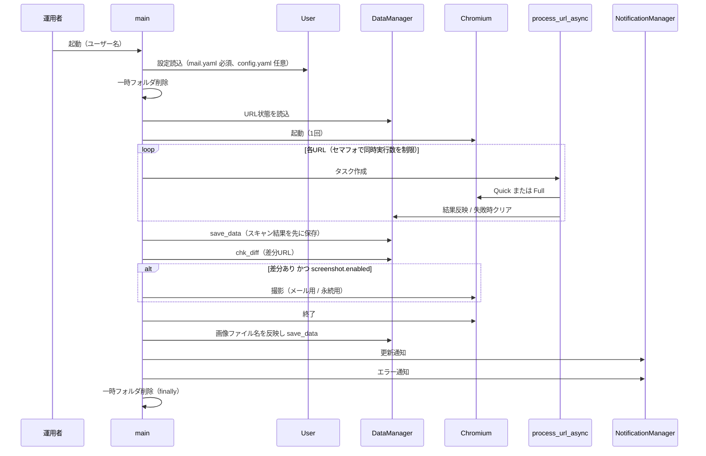
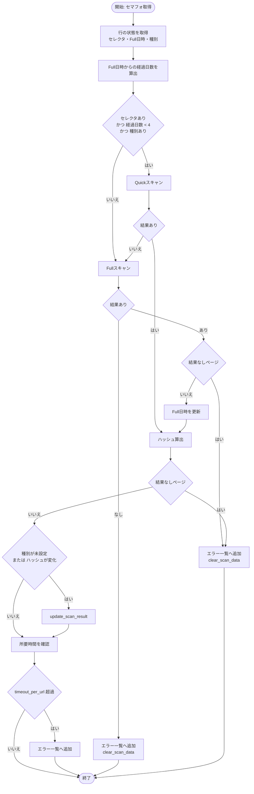
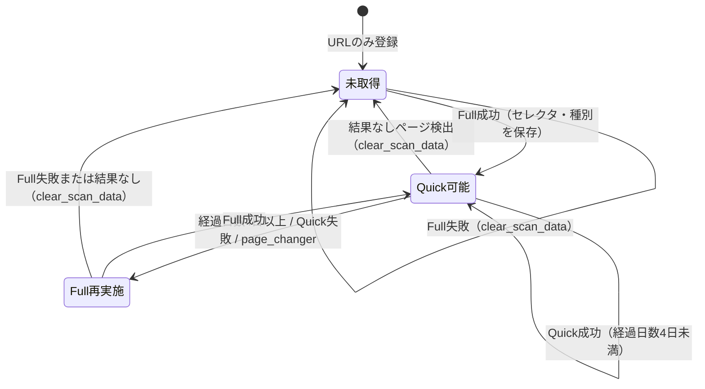

# 詳細設計書（Web更新チェッカー モジュール挙動・関数契約・DTO）
**スキャン方針決定、メインコンテンツ検出、更新検知、通知の制御仕様**

---

## 1. 概要

### 1.1 本書の目的と範囲

WCM-BD-001 で定義した構成要素（C-001〜C-009）の内部制御を定義する。永続化される形式（`cheacker_url.json` など）は WCM-DS-001 を正本とし、本書では参照だけを行う。

### 1.2 本書のSSOT範囲と文書境界

- **本書の正本範囲**: `module_behavior`。制御フロー、関数契約、DTO、状態遷移、エラー・再試行を定義する。
- **基本設計との境界**: 全体方針・責務・依存方向は WCM-BD-001 を正本とする。
- **データ構造との境界**: 保存形式、スキーマ、原子書き込みは WCM-DS-001 を正本とする。
- **外部公開**: 本システムに外部公開機能は無い。外部システム（Webサイト、SMTP、Google検索）との接続契約は、3.4〜3.9 の各節に記載する。
- **テスト**: 本書は機能テスト要件（TR-xxx）のみ定義する。テストケースと結果は [テスト設計書](../test/test_design_content_extractor.md) と今後作成するテスト計画・結果報告書を正本とする。

### 1.3 対象機能一覧

| 機能ID | 機能名                                     | 実装                                                         | 公開範囲         | 節   |
| :----- | :----------------------------------------- | :----------------------------------------------------------- | :--------------- | :--- |
| F-001  | 実行制御（バッチ全体）                     | `src/web-cheackerV3.py` `main`                               | 内部             | 3.1  |
| F-002  | ユーザー設定の読込                         | `User`                                                       | 内部             | 3.2  |
| F-003  | URL状態の管理と保存                        | `DataManager`                                                | 内部             | 3.2  |
| F-004  | スキャン方針決定（URL単位）                | `process_url_async`                                          | 内部             | 3.3  |
| F-005  | Fullスキャン                               | `extract_main_content`                                       | 内部             | 3.4  |
| F-006  | Quickスキャン                              | `quick_extract_content`                                      | 内部             | 3.5  |
| F-007  | メインコンテンツのスコアリング             | `MainContentScorer`、`rescore_main_content_with_children`    | 内部             | 3.6  |
| F-008  | ページ種別判定と最新ページ追従             | `WebTypeCHK`、`PageMonitor`                                  | 内部             | 3.7  |
| F-009  | ページ準備・robots.txt・スクリーンショット | `playwright_helpers.py`                                      | 内部             | 3.7  |
| F-010  | 検索結果ページの品質評価                   | `search_quality.evaluate`、`RelevanceScorer`                 | 内部（単体実行） | 3.8  |
| F-011  | 検索妥当性検証                             | `search_quality/search_and_validate.py`                      | 内部（単体実行） | 3.8  |
| F-012  | 通知（更新・エラー）                       | `NotificationManager`、`send_email`、`generate_html`         | 内部             | 3.9  |
| F-013  | 横断基盤（ログ・パス作成・JSON保存）       | `utils.setup_logger`、`utils.util_str`、`utils.file_handler` | 内部             | 3.10 |

---

## 2. 共通方針

### 2.1 例外処理

[ADR-002](../adr/ADR-002_exception-handling-policy.md) に従う。

| 区分                     | 方針                                                                                                     | 該当箇所                                                |
| :----------------------- | :------------------------------------------------------------------------------------------------------- | :------------------------------------------------------ |
| 内部モジュール           | 想定される具体例外（Playwright、aiohttp、OS）だけ捕捉し、`None` を返す。想定外の例外は記録して再送出する | `content_extractor/` 全般                               |
| フォールバック可能な処理 | 具体例外を記録して継続する                                                                               | セレクタ試行、ページ解放、日時解析、`Last-Modified`取得 |
| 最上位バッチ境界         | `Exception` を捕捉し、スタックトレースを記録し、エラー一覧へ追加して次のURLへ進む                        | `process_url_async`、`search_and_validate.main`         |

### 2.2 スキャンの2モードと最新ページ追従

- **Fullスキャン**: DOM全体を取得して本文領域を特定し、セレクタ候補を保存する。
- **Quickスキャン**: 保存済みセレクタで本文領域だけを取得する。
- いずれも結果は DTO `DOMTreeSt`（4章）で返す。

### 2.3 時刻

- 内部の保存時刻は UTC の ISO 8601（末尾 `Z`）とする。解析は ISO 8601 を先に試し、失敗した場合は旧形式（`YYYYMMDD HH:MM:SS` など10種）を UTC として解釈する。タイムゾーンを持たない ISO 形式（例: `2024-01-02 03:04:05`）も UTC として扱う。いずれも解析できない場合は `1970-01-01T00:00:00Z` を用いて警告する。
- Fullスキャンの要否は、`full_scan_datetime` と現在時刻の差を「日数（切り捨て）」で比較する。空欄または解析不能の場合は99日とみなす。

---

## 3. モジュール別詳細

### 3.1 実行制御（F-001）

**契約**: `main()` はコマンド引数の第1引数をユーザー名とする（省略時 `jav`）。戻り値は無い。

| 手順 | 内容                                                                                                                             | 失敗時                                       |
| :--- | :------------------------------------------------------------------------------------------------------------------------------- | :------------------------------------------- |
| 1    | `User` を生成する。`users/` 配下のディレクトリと必要ファイルを自動作成し、`mail.yaml` と設定を読み込む                           | `mail.yaml` が無い場合は例外で終了する       |
| 2    | 設定 `screenshot.temporary_dir`（既定 `temp_image`）を削除する                                                                   | -                                            |
| 3    | `DataManager` を生成し、各行の URL が空でないものにタスクを作る                                                                  | -                                            |
| 4    | `scan.worker_threads`（既定2）個のセマフォで同時実行数を制限し、`asyncio.gather` で全完了を待つ                                  | 個別失敗は 3.3 で隔離済み                    |
| 5    | `save_data` で保存し、`chk_diff` で差分URLを得る                                                                                 | -                                            |
| 6    | 差分があり `screenshot.enabled` が真なら、メール用（`email_width`、既定500）と永続用（`permanent_width`、既定1920）の2回撮影する | 個別URLの失敗は `None` で返り、処理は続く    |
| 7    | ブラウザを閉じ、永続画像のファイル名を `image_filename` に反映して再保存する                                                     | -                                            |
| 8    | 更新通知、エラーログ出力、エラー通知を行う                                                                                       | 通知送信の例外は伝播する（データは保存済み） |
| 9    | `finally` で一時フォルダを再度削除する                                                                                           | -                                            |

注: 撮影の有効可否は `notification.type` を確認しない。永続画像の保存先は設定値ではなく `users/<名前>/data/images` 固定である。

### 3.2 設定と状態管理（F-002、F-003）

#### User

| 項目       | 内容                                                                                                                                          |
| :--------- | :-------------------------------------------------------------------------------------------------------------------------------------------- |
| 入力       | ユーザーディレクトリ名                                                                                                                        |
| 副作用     | `users/`、`users/<名前>/cheacker_url.json`、`json/`、`data/images` を無ければ作成する                                                         |
| 設定の解決 | `users/<名前>/config.yaml` を優先し、無ければ `users/config.yaml`、どちらも無ければ警告して空設定。YAML不正・読込失敗時はエラーを記録し空設定 |
| 通知送信   | `mail.yaml` の `gmail.receiver_mail` 宛に `send_email` を呼ぶ。`mail.yaml` が空（None）の場合は送信せず警告する                               |

#### DataManager

| 操作                         | 契約                                                                                                                                                                                                                      |
| :--------------------------- | :------------------------------------------------------------------------------------------------------------------------------------------------------------------------------------------------------------------------ |
| 生成                         | JSONを読み込む。ファイルが無い・不正な場合は、必須列を持つ空の表で開始する。列が不足していれば補う。欠損値は空文字へ置換し、`css_selector_list` がリストでなければ空リストにする。読込直後の複製を `before_df` に保持する |
| `get_record_as_dict`         | 行を辞書で返す                                                                                                                                                                                                            |
| `update_scan_result`         | `result_vl`（`links` のSHA-256）、`updated_datetime`、`css_selector_list`、`web_page_type` を更新し、URLが変わっていれば URL も更新する                                                                                   |
| `update_full_scan_timestamp` | `full_scan_datetime` のみ現在時刻にする                                                                                                                                                                                   |
| `clear_scan_data`            | `css_selector_list` を空にし、`full_scan_datetime` を空にする（次回Fullスキャンを促す）。`result_vl` と `updated_datetime` は変更しない                                                                                   |
| `update_image_filename`      | URLが一致する行の `image_filename` に、パスを除いたファイル名を設定する                                                                                                                                                   |
| `save_data`                  | ロックを取り、全行の `run_code` を現在時刻にし、`<保存先>.tmp` へ書いてから置換する（WCM-DS-001 §4）                                                                                                                      |
| `chk_diff`                   | `result_vl` が `before_df` と異なる行のURLを返す。初回（`result_vl` が空）のURLは、ハッシュが設定されるため差分として扱う                                                                                                 |

注: `update_record_from_dom_tree` は `update_scan_result` とほぼ同じ内容を持つが、本流から呼ばれない。

### 3.3 スキャン方針決定（F-004）

**契約**: `process_url_async(url, index, data_manager, error_list, config, semaphore, browser)` は戻り値を持たない。結果は `data_manager` と `error_list` へ反映する。

規則:

1. Quickスキャンの条件は、セレクタ一覧が空でなく、Full実施から4日未満で、`web_page_type` が設定済みであること。
2. Quickが `None` を返した場合は、同じ呼び出しの中でFullへ進む。
3. Fullが `None` を返した場合は、`Full scan returned None` をエラー一覧へ追加し、`clear_scan_data` を呼んで終了する。
4. 「結果なし」と判定された場合（`is_empty_result` が真）は `Empty result page detected` をエラー一覧へ追加し、`clear_scan_data` を呼んで終了する。
5. 更新の判定は、ハッシュが前回の `result_vl` と異なる場合、または `web_page_type` が空（初回）の場合に状態を更新する。ハッシュが同じなら状態は変更しない。
6. 所要時間が `scan.timeout_per_url`（既定60秒）を超えた場合、実行中の中断はせず、超過メッセージをエラー一覧へ追加する。
7. 例外は、`Exception` を捕捉してスタックトレースを記録し、`[URL, 例外, 該当行, 行番号]` をエラー一覧へ追加する（`clear_scan_data` は呼ばない）。
8. Quickスキャン経路で `page_changer` 種別によりFullスキャンへ切り替わった場合（3.5）、`full_scan_datetime` は更新されない。

### 3.4 Fullスキャン（F-005）

**契約**: `extract_main_content(url, browser, count=0, arg_webtype=None)` は `DOMTreeSt` または `None` を返す。

| 手順 | 内容                                                                                                                                       |
| :--- | :----------------------------------------------------------------------------------------------------------------------------------------- |
| 1    | `robots.txt` が拒否していれば `None`                                                                                                       |
| 2    | `setup_page` でページを準備する。失敗したら `None`                                                                                         |
| 3    | `adjust_page_view`: ページ全体のサイズを測り、ビューポートをそのサイズへ拡大し、最下部へスクロールして2秒待つ                              |
| 4    | `make_tree` で `body` 以下のDOMツリーを作る。空なら `None`                                                                                 |
| 5    | `WebTypeCHK` でページ種別を判定する。次ページURLがあり再帰回数が3未満なら、ページを閉じて新URLで再帰呼び出しする                           |
| 6    | `MainContentScorer.find_candidates` で候補を得る。無ければ `None`                                                                          |
| 7    | 再評価ループ（最大5回）: 最有力候補の子孫を再スコアリングし、先頭が自身であるか自身のスコア以下になるまで、先頭の子孫へ移る                |
| 8    | `ensure_unique_selector` で、最終候補のセレクタがページ内で複数ヒットする場合に、位置が一致する要素の `nth-of-type` 付き絶対パスへ置換する |
| 9    | セレクタ候補一覧を作る: 最終候補の子孫のうち再評価順位2〜4位のセレクタ（空を除く）に、最終候補自身のセレクタを先頭へ加える                 |
| 10   | `url` を設定し、`web_type` を決める。`arg_webtype` がある場合は、優先度が高い方（4章）を採用する。`is_empty_result` は偽                   |
| 11   | `DOMTreeSt.to_dict()` を `data/<ドメイン>.json` に保存する                                                                                 |
| 12   | `finally` でページとコンテキストを解放する（再帰呼び出し前に解放した場合は二重に閉じない）                                                 |

最新ページへ追従した場合、結果の `url` は追従先のURLになる。`update_scan_result` は、この `url` が行のURLと異なるとき、行のURLを追従先へ置換する（監視対象URLが最新ページへ移っていく）。

例外: Playwrightのタイムアウト、Playwrightエラー、HTTPエラー、OSエラーは記録して `None`。それ以外は記録して再送出する。

### 3.5 Quickスキャン（F-006）

**契約**: `quick_extract_content(url, browser, css_selector_list, webtype_str)` は `DOMTreeSt` または `None` を返す。

| 順   | 判定・処理                                                                                                        |
| :--- | :---------------------------------------------------------------------------------------------------------------- |
| 1    | 種別が `page_changer` または `not_quickscan` なら、Fullスキャンを実行してその結果を返す                           |
| 2    | セレクタ一覧が空なら、Fullスキャンを実行してその結果を返す                                                        |
| 3    | `robots.txt` が拒否していれば `None`                                                                              |
| 4    | 新しいコンテキストでページを開く（`domcontentloaded`、10秒）                                                      |
| 5    | 各セレクタを順に試す。クラス名中のコロンはエスケープする。要素出現を5秒待ち、`make_tree` でその要素以下を取得する |
| 6    | 最初に成功したセレクタを一覧の先頭へ移し、`css_selector` と `css_selector_list` に設定する                        |
| 7    | すべて失敗したら `None`                                                                                           |
| 8    | 成功時は `url` と `web_type` を設定して返す                                                                       |

注: Quickの成功結果では `is_empty_result` は偽のまま（品質評価を行わない）。コンテキストは `finally` で閉じる。

### 3.6 メインコンテンツのスコアリング（F-007）

候補選定の第1段階（`find_candidates`）と、絞り込みの第2段階（`score_parent_and_children`）の2段階で評価する。

**候補として無効なノード**: タグが空、タグが `NAV`・`ASIDE`・`HEADER`・`FOOTER`・`MENU`・`BODY`・`HTML`、面積が100px²未満。

**基本スコア**（2段階で共通）: 次の項目の積。

| 項目           | 内容                                                                                            |
| :------------- | :---------------------------------------------------------------------------------------------- |
| 画面占有率     | 要素面積 ÷ 評価領域面積。ガウス関数（中心0.8、標準偏差0.3）で倍率化                             |
| 横位置（中心） | 評価領域に対する中心X比。正規分布（平均0.5、標準偏差0.35）の確率密度                            |
| 縦位置（上端） | 評価領域に対する上端Y比。正規分布（平均0.5、標準偏差0.35）の確率密度                            |
| 幅             | 評価領域に対する幅比。ガンマ分布（形状6.7、尺度0.11）の確率密度                                 |
| 高さ           | 高さ比（上限0.9）の1.5乗                                                                        |
| リンク数       | 0件は0.1。6件以下は平均6、標準偏差5、6件超は標準偏差30のガウス関数。重み1.0                     |
| テキスト量     | 0文字は0。50文字以下は平均50、標準偏差40、50文字超は標準偏差1000のガウス関数。重み1.5（べき乗） |

**段階別の加算**:

- 第1段階: `<main>` タグ、または `id` に `main`（大文字小文字不問）を含む要素へ +0.5。
- 第2段階: 基準を最上位ノードの深さとした相対深さに対し、`4^(相対深さ ÷ 5)` を掛ける。

**再評価**: 親要素の位置を原点、親要素のサイズを評価領域として、親自身と全子孫を再スコアリングする。

### 3.7 ページ種別判定・ページ準備・robots.txt・撮影（F-008、F-009）

#### ページ種別判定（`WebTypeCHK`）

| 項目               | 内容                                                                                                                                                            |
| :----------------- | :-------------------------------------------------------------------------------------------------------------------------------------------------------------- |
| 種別               | `plane`（優先度1）、`page_changer`（優先度2）、`not_quickscan`（優先度3）。優先度の高い方を採用する                                                             |
| 判定               | 監視URLに `page` + 区切り（`-`・`=`・`/` のいずれか、省略可）+ 数字を含めば `page_changer`、それ以外は `plane`。`not_quickscan` は自動判定されない              |
| 最新ページ追従     | 同一ドメインのリンクのうち、`page` + 区切り（`-`・`=`・`/`）+ 数字の最大番号を持つものを探す。現在のURLの番号より大きい場合のみ、絶対URLに解決して次のURLとする |
| 不明な文字列の扱い | `WebType.from_string` は未知の値、非文字列を `plane` として扱う                                                                                                 |

#### ページ準備（`setup_page`、`close_page`）

- 1920×1080のコンテキストを作成し、`domcontentloaded` を10秒、`body` の出現を10秒、ネットワークアイドルを15秒（超過は警告して続行）待つ。
- 失敗時は作成済みのページとコンテキストを個別に解放して `None`（想定外の例外は再送出）。
- `close_page` はページとそのコンテキストを閉じる。閉じる処理の失敗は記録のみ。

#### robots.txt（`is_url_allowed`）

- オリジン（スキーム＋ホスト）ごとに1回だけ取得してキャッシュする。取得失敗（`None`）もキャッシュする。オリジン単位のロックで同時取得を防ぐ。
- URLの解析ができない場合、`robots.txt` が無い場合、取得できない場合は許可（真）とする。
- 判定は、ユーザーエージェント `*` として `can_fetch` を用いる。

#### スクリーンショット（`save_screenshot`）

- 入力URLごとに順次処理する。URLが不正または `robots.txt` が拒否している場合は `None` を結果に入れる。
- 成功時は保存したファイルパス、失敗時は `None` を、入力と同じ順序で返す（呼び出し側は添字で対応付ける）。
- 1920×1080のコンテキストで `load` を30秒待ち、フルページ画像を保存し、指定幅（高さは縦横比維持）へ縮小して上書きする。最大3回試行し、間隔は2秒。
- ファイル名は `<ドメイン（. を _ に置換）>_<パス最終要素>_<パスのMD5先頭8桁>.png`。同じURLは同名で上書きされる。

### 3.8 品質評価と検索妥当性検証（F-010、F-011）

`search_quality.evaluate.evaluate_search_quality(url, browser, search_query)` は、監視本流とは独立した任意機能である。`search_quality` パッケージは `content_extractor`（抽出処理）を利用するが、`content_extractor` は `search_quality` を参照しない。単体実行は `python -m search_quality.evaluate <URL> --query <クエリ>`（`src` を `PYTHONPATH` に加える）。

| 段階 | 処理                                                                                                                                                                                                 |
| :--- | :--------------------------------------------------------------------------------------------------------------------------------------------------------------------------------------------------- |
| 0    | `extract_main_content` を実行する。`None` なら `None`                                                                                                                                                |
| 1    | 「結果なし」判定（`is_no_results_page`）: 本文にキーワードが含まれる、または「結果なし」セレクタが存在すれば真。期待される結果コンテナが存在すれば偽。いずれも見つからなければ真                     |
| 2    | 結果アイテムの定量化: 子要素の `class` が最も繰り返されるノード（繰り返し数×純度が最大）を結果コンテナとし、リンクを1件以上持ち、10語以上のテキストを持つ子を有効アイテムとする。0件なら「結果なし」 |
| 3    | 関連性スコア = 0.2×ジャカード + 0.3×TF-IDFコサイン + 0.5×埋め込みコサイン。平均・分散・最大を算出する                                                                                                |
| 4    | SQS = 100 ×（ln(件数+1)×0.2 + 平均×0.4 − 分散×0.2 + 最大×0.2）。下限0。60以上は `Valid`、20以上は `Low Quality`、それ未満は `Invalid/Empty`（重みと閾値は `quality_config.json`）                    |

- 現状、`is_empty_result` を真にするのは品質評価だけである。品質評価は本流から呼ばれないため、3.3 の「結果なしページ」の分岐は本流では到達しない。
- 「結果なし」の判定語・セレクタは `src/search_quality/config/no_results_config.json`。設定ファイルが無い、またはJSONが不正な場合は、実装内の既定値を使う。
- `RelevanceScorer` は `scikit-learn` と `sentence-transformers` が無ければ `ImportError` を送出する（埋め込みモデルは `all-MiniLM-L6-v2`）。
- 品質評価は、メインコンテンツ抽出のためにページを開いた後、判定のために同じURLを再度開く（2回アクセスする）。

`search_and_validate.main(keyword)`: Googleの検索結果のURLを取得し、上位5件を品質評価する。カテゴリが `Valid` で、本文にキーワードが含まれるものを「妥当」として一覧に出す。

### 3.9 通知（F-012）

| 通知種別   | 送信条件                                                                                       | 内容                                                                                                          |
| :--------- | :--------------------------------------------------------------------------------------------- | :------------------------------------------------------------------------------------------------------------ |
| 更新通知   | 差分URLが1件以上で、`notification.type` が `email`                                             | HTML本文（URL、安全なURLのみリンク、画像は `cid` 参照）。画像は撮影成功分だけ添付し、失敗分は「取得失敗」表示 |
| エラー通知 | エラー一覧が1件以上で、`notification.type` が `email` かつ `notification.notify_on_error` が真 | エラー一覧を箇条書きにしたHTML。各要素はエスケープする                                                        |

- `send_email`: Gmail の `smtp.gmail.com:587` に接続し、STARTTLS後にログインして1通送る。件名は空文字、受信者は `mail.yaml` の `gmail.receiver_mail`。画像の `Content-ID` は、画像一覧の添字による `image_<添字>`。タイムアウトと再試行は設定していない。
- HTML本文の `cid` は、画像一覧のうち `None` でないものの添字から `image_<添字>` として生成する。メール側の `Content-ID` と同じ規則で対応する。

### 3.10 横断基盤（F-013）

| 機能                           | 契約                                                                                                                                                                                                    |
| :----------------------------- | :------------------------------------------------------------------------------------------------------------------------------------------------------------------------------------------------------ |
| `setup_logger`                 | ロガー名ごとに1度だけハンドラーを構成する。標準出力はINFO以上（色付き可）、ファイルはDEBUG以上で10MB・5世代。`level` 引数は現状反映されない（ロガー自体はDEBUG固定）                                    |
| `util_handle_path`             | 末尾が区切り文字（`/`、`\`）ならディレクトリ（`custom_filename` 指定時はその配下のファイル）、拡張子があればファイル、無ければディレクトリを、無ければ作成する。権限は変更せず、作成不可の場合は `None` |
| `get_domain`                   | URLのネットロケーション部を返す                                                                                                                                                                         |
| `utils.file_handler.save_json` | `<directory>/<ドメイン（ファイル名に使えない文字は _ に置換）>.json` に整形JSON（UTF-8、日本語はそのまま）で保存する。既定ディレクトリは `data`                                                         |
| `create_shortcut`              | 仮想環境の有無を確認して `web-cheackerV3.py` （`src/web-cheackerV3.py`）を起動するバッチ `cheack.bat` を生成する                                                                                        |

---

## 4. DTO

### 4.1 DOMTreeSt（抽出結果・DOMノード）

モジュール間（`make_tree` → `scorer` → `core` → `web-cheackerV3`）で受け渡す。永続化は `to_dict()` の一部のみ（WCM-DS-001 §5）。

| フィールド                         | 型                   | 内容・制約                                                                                       |
| :--------------------------------- | :------------------- | :----------------------------------------------------------------------------------------------- |
| `tag`、`id`、`attributes`          | 文字列、文字列、辞書 | 要素名（小文字）、ID、全属性                                                                     |
| `children`                         | `DOMTreeSt` のリスト | 直接の子要素のうち、描画されているもの                                                           |
| `rect`                             | `BoundingBox`        | ビューポート相対の位置とサイズ（ピクセル）                                                       |
| `depth`                            | 整数                 | ルートを1とする深さ                                                                              |
| `text`                             | 文字列               | `innerText` の前後空白除去済み                                                                   |
| `score`                            | 小数                 | 直近のスコアリング結果（段階により意味が変わる）                                                 |
| `css_selector`                     | 文字列               | 最も具体的な単一セレクタ（IDがあれば `tag#id`、なければ `tag.class...`）。識別子はエスケープ済み |
| `css_selector_list`                | 文字列のリスト       | 代替セレクタ。Quickの試行順                                                                      |
| `links`                            | 文字列のリスト       | 配下の `a` の `href` を昇順に並べたもの。ハッシュ計算の入力                                      |
| `chk_url`                          | 文字列               | 現在は使われていない                                                                             |
| `url`                              | 文字列               | 抽出元URL。`to_dict` に含まれない                                                                |
| `web_type`                         | 文字列               | `plane`、`page_changer`、`not_quickscan` のいずれか                                              |
| `result_count`、`result_items`     | 整数、リスト         | 品質評価で設定                                                                                   |
| `relevance_score` ほか品質評価項目 | 小数、文字列         | `avg_relevance`、`relevance_variance`、`max_relevance`、`sqs_score`、`quality_category`          |
| `is_empty_result`                  | 真偽                 | 「結果なし」と判定されたときに真                                                                 |

### 4.2 その他の受け渡し値

| 名称          | 型・内容                                                                         |
| :------------ | :------------------------------------------------------------------------------- |
| `BoundingBox` | `x`、`y`、`width`、`height`（小数）                                              |
| エラー一覧    | リスト。要素は `[URL, メッセージ]`、または例外時の `[URL, 例外, 該当行, 行番号]` |
| 画像一覧      | 入力URL一覧と同順の、ファイルパス（文字列）または `None` のリスト                |
| 設定（辞書）  | `scan`、`notification`、`screenshot` の3キー。既定値は WCM-DS-001 §6             |

---

## 5. 状態遷移

URL1件の状態（`cheacker_url.json` の1行）は、保存値の組み合わせで次のように遷移する。保存値は WCM-DS-001 を正本とする。

「未取得」は、セレクタ一覧と `full_scan_datetime` が空の状態であり、`result_vl` は直前の値を保持する。

---

## 6. エラー処理一覧

| 事象                                       | 検出箇所                  | 処理                                                               | 利用者への伝達                   |
| :----------------------------------------- | :------------------------ | :----------------------------------------------------------------- | :------------------------------- |
| `mail.yaml` が無い                         | `User`                    | 例外で起動失敗                                                     | コンソール                       |
| `config.yaml` が不正                       | `User`                    | エラーを記録し空設定                                               | ログ                             |
| robots.txt が拒否                          | Full、Quick、撮影         | `None`（撮影はURLごとに `None`）                                   | ログ（Fullはエラー一覧にも追加） |
| ページ取得のタイムアウト・Playwrightエラー | `setup_page`、Full、Quick | リソース解放後に `None`                                            | ログ、エラー一覧                 |
| メインコンテンツ候補なし                   | Full                      | `None`                                                             | エラー一覧                       |
| 結果なしページ                             | 3.3                       | `clear_scan_data`                                                  | エラー一覧                       |
| 想定外の例外                               | `process_url_async`       | スタックトレース記録、エラー一覧へ追加し、次のURLへ                | ログ、エラー一覧                 |
| 処理時間超過                               | `process_url_async`       | 記録のみ                                                           | エラー一覧                       |
| 撮影失敗                                   | `save_screenshot`         | 3回再試行後 `None`。通知本文は「スクリーンショット取得失敗」と表示 | メール本文                       |
| メール送信失敗                             | `send_email`              | 例外が伝播する。保存済みデータは失われない                         | コンソール                       |

---

## 7. 機能テスト要件

テストケースと結果は、テスト設計書および今後のテスト計画・結果報告書を正本とする。ここでは機能が保証すべき振る舞いのみを要件IDで定義する。

| 要件ID | 対象  | 保証する振る舞い                                                                        |
| :----- | :---- | :-------------------------------------------------------------------------------------- |
| TR-001 | F-002 | ユーザー設定は、ユーザー専用、共通、空設定の優先順で解決される                          |
| TR-002 | F-003 | ファイルが無い・不正でも、必須列を持つ空の状態で開始できる                              |
| TR-003 | F-003 | 保存は一時ファイル経由で行われ、書き込み中の失敗で既存ファイルを壊さない                |
| TR-004 | F-003 | `chk_diff` は `result_vl` が変化した行のURLだけを返す                                   |
| TR-005 | F-003 | `clear_scan_data` はセレクタ一覧とFull日時のみを消去し、ハッシュを保持する              |
| TR-006 | F-004 | セレクタ・種別・4日未満の条件を満たすときだけQuickを試み、失敗時はFullへ進む            |
| TR-007 | F-004 | Full失敗・結果なし・例外のとき、他のURLの処理は継続される                               |
| TR-008 | F-004 | 同じリンク集合ならハッシュ・状態は変化しない                                            |
| TR-009 | F-005 | robots.txt が拒否するURLにアクセスしない（Full、Quick、撮影の各経路）                   |
| TR-010 | F-005 | 保存するプライマリセレクタは、ページ内で複数ヒットする場合に一意なパスへ置換される      |
| TR-011 | F-005 | 再評価ループは最大5回で終了する                                                         |
| TR-012 | F-006 | `page_changer` 種別、またはセレクタ一覧が空のQuickは、Fullスキャンにフォールバックする  |
| TR-013 | F-006 | 最初に成功したセレクタが一覧の先頭へ移る                                                |
| TR-014 | F-007 | 除外タグ・面積100px²未満の要素は候補にならない                                          |
| TR-015 | F-007 | `<main>` および `id` に `main` を含む要素は第1段階で加点される                          |
| TR-016 | F-008 | ページ番号付きURLは `page_changer`、それ以外は `plane` と判定される                     |
| TR-017 | F-008 | 別ドメインのリンクは最新ページ候補から除外され、現在より大きい番号のときだけ次URLとなる |
| TR-018 | F-008 | 最新ページへの追従は最大3回で終了する                                                   |
| TR-019 | F-009 | robots.txt はオリジンごとに1回だけ取得され、取得失敗時は許可として扱われる              |
| TR-020 | F-009 | 撮影結果は入力URLと同順で、失敗した要素は `None` になる                                 |
| TR-021 | F-010 | 結果なしキーワード・セレクタを検出するとき、結果なしページと判定される                  |
| TR-022 | F-010 | SQSは、重み・閾値に従って `Valid`、`Low Quality`、`Invalid/Empty` に分類される          |
| TR-023 | F-010 | 追加依存が無い環境で `RelevanceScorer` を生成すると `ImportError` になる                |
| TR-024 | F-012 | `notification.type` が `email` 以外なら、更新通知・エラー通知を送らない                 |
| TR-025 | F-012 | 通知本文のURL・文字列はエスケープされ、`http`/`https` 以外はリンク化されない            |
| TR-026 | F-012 | 画像の `cid` が、HTML本文とメール添付で一致する                                         |
| TR-027 | F-013 | `util_handle_path` は拡張子の有無でファイル・ディレクトリを作り分ける                   |

---

## 8. 作成完了チェック

- [x] 対象機能一覧、機能ID、公開範囲を記入した。
- [x] 機能ごとの制御フロー・入出力・エラー処理を記入した。
- [x] DTO を記入し、永続化形式は WCM-DS-001 へ委譲した。
- [x] 状態遷移とエラー処理一覧を記入した。
- [x] 機能テスト要件（TR-xxx）を記入し、テストケースを再掲していない。
- [x] 具象ソースコードを掲載していない。

---

## 9. 改訂履歴 (Change Log)

| 版数    | 改訂日     | 変更者 | 変更内容・変更理由 (Why)                                                                                                                                       |
| :------ | :--------- | :----- | :------------------------------------------------------------------------------------------------------------------------------------------------------------- |
| Rev.0.1 | 2026-11-24 | xzyozi | 既存実装（develop 7f5d248）から逆起こしして新規作成。設計書が未整備だったため                                                                                  |
| Rev.0.2 | 2026-11-24 | xzyozi | src 配下への移行、品質評価の分離（search_quality）、utils 集約に合わせてパスを更新。タイムゾーンなし日時の扱いと、本流で到達しない「結果なしページ」分岐を追記 |
