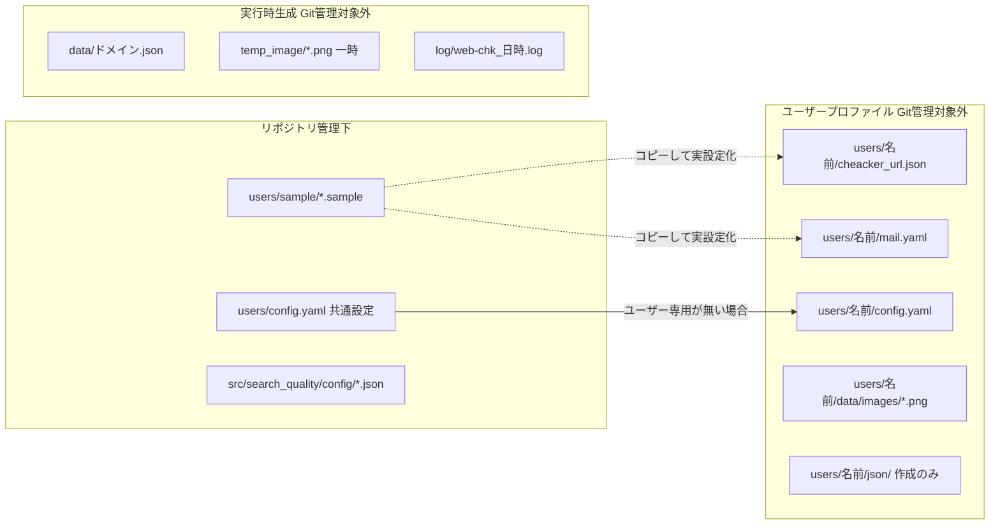

# データ構造仕様書（Web更新チェッカー 永続化データ・設定・保存状態）
**URL状態JSON、設定YAML、画像・ログ・抽出結果の配置と保存契約**

---

## 1. 概要

### 1.1 本書の目的と範囲

本システムがディスクへ書き込む、またはディスクから読み込むデータの構造を定義する。モジュール間で受け渡すメモリ上のデータ（DTO）は WCM-DD-001 を正本とする。

- **対象範囲**: URL状態ファイル、通知設定、アプリ設定、画像、一時フォルダ、ドメイン別抽出結果、ログ、品質評価設定。
- **対象外範囲**: データベース（使用しない）、環境変数（使用しない）、プロジェクト管理のためのファイル（`pyproject.toml`、`uv.lock` は環境・開発基盤の範囲）。
- **本書の正本範囲**: `persistent_data`。
- **記述の基準**: 本書は現行実装の挙動を記述する。

### 1.2 データ配置の全体像

| 区分         | パス（カレントディレクトリ基準）                      | 生成・更新者                       | Git管理          | 書き込み契機                      |
| :----------- | :---------------------------------------------------- | :--------------------------------- | :--------------- | :-------------------------------- |
| URL状態      | `users/<名前>/cheacker_url.json`                      | `DataManager`（初期作成は `User`） | 対象外           | スキャン完了後と画像名反映後の2回 |
| 通知設定     | `users/<名前>/mail.yaml`                              | 運用者が作成                       | 対象外           | 実行時は読み取りのみ              |
| アプリ設定   | `users/<名前>/config.yaml` または `users/config.yaml` | 運用者が作成                       | 共通設定のみ対象 | 実行時は読み取りのみ              |
| 永続画像     | `users/<名前>/data/images/*.png`                      | `save_screenshot`                  | 対象外           | 差分URLごと                       |
| メール用画像 | `temp_image/*.png`（設定値で変更可）                  | `save_screenshot`                  | 対象外           | 差分URLごと。実行前後に削除       |
| 抽出結果     | `data/<ドメイン>.json`                                | `utils.file_handler.save_json`     | 対象外           | Fullスキャン成功ごと              |
| ログ         | `log/web-chk_<YYYYMMDD_HHMMSS>.log`                   | `utils.setup_logger`               | 対象外           | 実行中                            |
| 品質評価設定 | `src/search_quality/config/*.json`                    | 開発者                             | 対象             | 実行時は読み取りのみ              |

---

## 2. URL状態ファイル（`cheacker_url.json`）

JSON配列で、1要素が監視対象1URLに対応する。正本となる唯一の永続状態である。

### 2.1 レコード定義

| フィールド           | 型           | 必須  | 既定・空値 | 内容・制約                                                                                                                                                                                                                                            |
| :------------------- | :----------- | :---: | :--------- | :---------------------------------------------------------------------------------------------------------------------------------------------------------------------------------------------------------------------------------------------------- |
| `url`                | 文字列       | 必須  | -          | 監視対象URL。空は処理対象外。最新ページへ追従した場合は追従先へ更新される                                                                                                                                                                             |
| `run_code`           | 文字列       | 任意  | 空         | 最後に保存した時刻（ISO 8601 UTC）。保存のたびに全行が同じ値へ上書きされる                                                                                                                                                                            |
| `result_vl`          | 文字列       | 任意  | 空         | メインコンテンツの `links`（`str` 化したリスト）のSHA-256（16進64桁）。更新判定の基準                                                                                                                                                                 |
| `updated_datetime`   | 文字列       | 任意  | 空         | 最後に状態を更新した時刻（ISO 8601 UTC）                                                                                                                                                                                                              |
| `full_scan_datetime` | 文字列       | 任意  | 空         | 最後にFullスキャンが成功した時刻。空の場合は次回Full                                                                                                                                                                                                  |
| `css_selector_list`  | 文字列の配列 | 任意  | 空配列     | Quickスキャンで試すセレクタ。先頭は、Fullが選んだ、またはQuickで成功したセレクタ。ハッシュ未変化時もFull結果およびQuickでの並べ替え結果が保存される。空の場合は次回Full |
| `web_page_type`      | 文字列       | 任意  | 空         | `plane`、`page_changer`、`not_quickscan` のいずれか。空は初回扱い（Full、状態を必ず更新）                                                                                                                                                             |
| `image_filename`     | 文字列       | 任意  | 空         | 永続画像のファイル名（パスを含まない）                                                                                                                                                                                                                |

読み込み時の補正:

- `image_filename`、`css_selector_list` の列が無ければ追加する（旧形式からの無停止移行）。
- 欠損値（null）は、`web_page_type`、`result_vl`、`full_scan_datetime`、`image_filename` について空文字へ置換する。
- `css_selector_list` が配列でない場合は空配列にする。
- 未知のフィールドは読み込み後も表に保持され、再保存でそのまま出力される。

時刻値は ISO 8601（UTC、末尾 `Z`）で保存する。読み込みは旧形式（`YYYYMMDD HH:MM:SS`、`YYYY-MM-DD HH:MM:SS` など）も受け付け、UTC として解釈する。タイムゾーンを持たない文字列も UTC として扱う。

### 2.2 保存状態（URL1件の状態分類）

| 状態分類       | 判別条件（保存値）                                                   | 次回実行時の挙動                                         |
| :------------- | :------------------------------------------------------------------- | :------------------------------------------------------- |
| 未登録（初回） | `web_page_type` が空                                                 | Full。結果は必ず保存する。差分として通知される           |
| Quick可能      | セレクタ非空、`web_page_type` 設定済、Full日時から4日未満            | Quick                                                    |
| Full再実施対象 | セレクタ空、またはFull日時が空、または4日以上経過                    | Full                                                     |
| 失敗直後       | セレクタ空かつFull日時が空（`result_vl`、`updated_datetime` は保持） | Full。ハッシュを保持するため失敗自体は更新扱いにならない |

状態の遷移条件は WCM-DD-001 §5 を正本とする。

### 2.3 初期ファイル

- `users/sample/cheacker_url.json.sample` が雛形である。`url` のみを書けば足りる。
- ファイルが無い場合、`User` が空ファイルを作成する。空ファイルや不正なJSONは「列だけを持つ空の表」として扱われ、URLは0件になる。

---

## 3. 通知設定（`mail.yaml`）

| キー                  | 型     | 必須  | 内容                                      |
| :-------------------- | :----- | :---: | :---------------------------------------- |
| `gmail.receiver_mail` | 文字列 | 必須  | 通知の宛先                                |
| `gmail.account`       | 文字列 | 必須  | 送信元アカウント。SMTPログインにも使う    |
| `gmail.password`      | 文字列 | 必須  | Gmailのアプリパスワード。平文で保存される |

- 雛形は `users/sample/mail.yaml.sample`。実ファイルは Git管理対象外。雛形にある `Settings.sendmail`（0/1）は、実装から参照されない。
- ファイルが無い場合、起動に失敗する。内容が空（YAMLがnull）の場合は、メール送信を行わず警告のみ。
- 文字コードの指定なしで読み込む（実行環境の既定に従う）。ASCII範囲の記述を推奨する。

---

## 4. 書き込みの契約（原子置換・排他制御）

対象は `cheacker_url.json` のみ。他のファイルは単純な上書きまたは新規作成であり、原子性は保証しない。

### 4.1 原子置換

| 手順 | 内容                                                                            |
| :--- | :------------------------------------------------------------------------------ |
| 1    | ロックを取得する                                                                |
| 2    | 全行の `run_code` を現在時刻にする                                              |
| 3    | `<保存先>.tmp` に全体を書き出す（インデント4、日本語はエスケープしない、UTF-8） |
| 4    | `os.replace` で保存先へ置換する                                                 |

- 書き込み途中の中断では、既存の保存先は変更されない。`.tmp` は残り得るが、次回の保存時に上書きされる。
- 保存は1回の実行で2回行う（スキャン直後、画像ファイル名の反映後）。1回目の後に失敗しても、スキャン結果は残る。

### 4.2 排他制御

- スレッドロック（プロセス内）で、読み込みと保存を囲む。処理は単一スレッドの asyncio で動くため、現状ではこのロックが競合を防ぐ場面は無い。
- プロセス間のロックは無い。同一ユーザープロファイルの二重起動では、後から保存した内容が先の保存内容を上書きする（更新が失われ得る）。同一ユーザーを同時に実行しない運用とする。
- 同時実行されるURL処理（非同期タスク）は、メモリ上の表のそれぞれ別の行を更新する。

### 4.3 読込失敗時の扱い

| 事象                   | 扱い                                                         |
| :--------------------- | :----------------------------------------------------------- |
| ファイルが無い         | 空の状態で開始する（保存時に新規作成される）                 |
| JSONが不正、または空   | 空の状態で開始する。既存ファイルは、次回の保存で上書きされる |
| 一部のフィールドが欠損 | 2.1 の補正を行う                                             |

注意: JSONが不正な場合に空の状態で開始して保存すると、元のファイルの内容は失われる。バックアップ機構は無いため、運用者は別途退避する。

---

## 5. 抽出結果ファイル（`data/<ドメイン>.json`）

Fullスキャン成功のたびに、`DOMTreeSt.to_dict()` の結果をUTF-8の整形JSONで保存する（監視本流が参照しない、確認・デバッグ用の出力）。

| 項目       | 内容                                                                                                                                             |
| :--------- | :----------------------------------------------------------------------------------------------------------------------------------------------- |
| ファイル名 | `<URLのネットロケーション部>.json`。ファイル名に使えない文字（ポート番号の `:` など）は `_` に置換する。ネットロケーションが空の場合は `unknown` |
| 上書き     | 同一ドメインの複数URLは、最後に成功したFullスキャンの結果で上書きされる                                                                          |
| 内容       | DOMツリー全体（子要素、座標、属性、リンク、スコア、セレクタ、品質評価項目）。`url` は含まれない                                                  |
| 肥大化     | 本文領域のツリー全体を含む。サイズの上限や世代管理は無い                                                                                         |

---

## 6. アプリ設定（`config.yaml`）

解決順序は、`users/<名前>/config.yaml`、`users/config.yaml`、空設定。キーが無い場合の既定値は実装内に定義されている。

| キー                           | 型     | 実装の既定値     | 内容                                                                               |
| :----------------------------- | :----- | :--------------- | :--------------------------------------------------------------------------------- |
| `scan.worker_threads`          | 整数   | 2                | 同時スキャン数（実体は非同期タスクの同時実行数）                                   |
| `scan.timeout_per_url`         | 数値   | 60               | 1URLの処理時間の閾値（秒）。超過は記録のみ                                         |
| `notification.type`            | 文字列 | `none`           | `email` または `none`                                                              |
| `notification.notify_on_error` | 真偽   | 偽               | エラー一覧をメールで通知するか。`type` が `email` のときのみ有効                   |
| `screenshot.enabled`           | 真偽   | 偽               | 差分URLのスクリーンショットを撮るか。`notification.type` は参照されない            |
| `screenshot.temporary_dir`     | 文字列 | `temp_image`     | メール用画像の一時フォルダ。実行前後に削除される。保存先に重要なファイルを置かない |
| `screenshot.email_width`       | 整数   | 500              | メール用画像の幅（px）                                                             |
| `screenshot.permanent_width`   | 整数   | 1920             | 永続画像の幅（px）                                                                 |
| `screenshot.permanent_dir`     | 文字列 | （参照されない） | 雛形に存在するが、実装は参照しない。実際の保存先は `users/<名前>/data/images` 固定 |

共通設定 `users/config.yaml`（リポジトリ管理）は、通知種別 `email`、エラー通知 無効、撮影 有効を設定している。

---

## 7. 画像ファイル

| 項目           | 内容                                                                                                                                                                                                                         |
| :------------- | :--------------------------------------------------------------------------------------------------------------------------------------------------------------------------------------------------------------------------- |
| 形式           | PNG（フルページ撮影後、指定幅へ縮小して上書き）                                                                                                                                                                              |
| ファイル名     | `<ドメイン（. を _ に置換）>_<パス最終要素、無ければ index>_<パスのMD5先頭8桁>.png`                                                                                                                                          |
| 上書き         | 同一URLは同名で上書きされる。ポート番号の `:` 等、ファイル名に使えない文字は `sanitize_filename_part` で `_` に置換される。永続画像は世代管理されない（過去の更新時点の画像は残らない） |
| 永続画像の参照 | `cheacker_url.json` の `image_filename`（ファイル名のみ）。保存先ディレクトリは `users/<名前>/data/images`                                                                                                                   |
| 一時画像       | 通知メールの添付用。実行の開始時と終了時（例外時も）にフォルダごと削除する                                                                                                                                                   |
| クエリ文字列   | ファイル名はパスのみから作る。クエリ違いの別URLは衝突し得る                                                                                                                                                                  |

---

## 8. ログファイル

| 項目           | 内容                                                                                                                                                                                                                               |
| :------------- | :--------------------------------------------------------------------------------------------------------------------------------------------------------------------------------------------------------------------------------- |
| 配置・名前     | `log/web-chk_<YYYYMMDD_HHMMSS>.log`（プロセス起動時の時刻）。実行1回につき1ファイル                                                                                                                                                |
| 出力レベル     | `web-cheacker` ロガー（`web-cheackerV3.py`、`content_extractor/core.py`）は、ファイルがDEBUG以上、標準出力がINFO以上。他のモジュールのロガーはファイルへ出力されない（標準出力のみ、または出力されない。#92 Q-010 で対応を検討中） |
| ローテーション | 1ファイル10MBで切替、5世代保持                                                                                                                                                                                                     |
| 文字コード     | UTF-8                                                                                                                                                                                                                              |
| 保持・削除     | 古い実行のログを削除する仕組みは無い。運用者が整理する                                                                                                                                                                             |
| 含まれる情報   | URL、DataFrame全体（URL、ハッシュ、セレクタ等）、抽出したセレクタ、スタックトレース。認証情報は含まれない                                                                                                                          |

---

## 9. 品質評価の設定ファイル（`src/search_quality/config/`）

| ファイル                 | キー                                                                                                                                | 既定（ファイル不備時の実装内既定）                        |
| :----------------------- | :---------------------------------------------------------------------------------------------------------------------------------- | :-------------------------------------------------------- |
| `quality_config.json`    | `sqs_weights`（`result_count`、`avg_relevance`、`relevance_variance`、`max_relevance`）、`sqs_thresholds`（`valid`、`low_quality`） | 重み 0.2 / 0.4 / 0.2 / 0.2。閾値 60 / 20                  |
| `no_results_config.json` | `keywords`（結果なしを示す語句の配列）、`no_results_selectors`、`expected_results_selectors`                                        | 実装内の既定語句（日英8語）、セレクタ4件、期待コンテナ3件 |

- ファイルが無い、またはJSONが不正な場合は、警告して実装内の既定値へ切り替える。キー単位の補完は行わない（ファイルが読めたときは、キー欠落でエラーになり得る）。

---

## 10. 移行・互換性

| 項目                 | 方針                                                                                   |
| :------------------- | :------------------------------------------------------------------------------------- |
| 旧形式の時刻         | 読み込みは旧形式も受け付け、保存時にISO 8601へ統一される                               |
| 旧形式のレコード     | 列が不足していれば補う。旧版のCSV（`data/cheacker_url.csv`）は現行実装から参照されない |
| 新規フィールドの追加 | 読み込み時に補う処理を追加し、雛形（`.sample`）を同時に更新する                        |
| バージョン識別       | ファイルにスキーマのバージョンは持たない                                               |

---

## 11. 作成完了チェック

- [x] 永続化されるファイルとその所有者・書き込み契機を記入した。
- [x] URL状態の列定義、必須性、補正、状態分類を記入した。
- [x] 原子置換と排他制御の契約、およびその限界を記入した。
- [x] 設定の既定値とGit管理区分、機密情報の扱いを記入した。
- [x] 具象ソースコードを掲載していない。

---

## 12. 改訂履歴 (Change Log)

| 版数    | 改訂日     | 変更者 | 変更内容・変更理由 (Why)                                                                                                                                  |
| :------ | :--------- | :----- | :-------------------------------------------------------------------------------------------------------------------------------------------------------- |
| Rev.0.1 | 2026-11-24 | xzyozi | 既存実装（develop 7f5d248）から逆起こしして新規作成。設計書が未整備だったため                                                                             |
| Rev.0.2 | 2026-11-24 | xzyozi | 品質評価設定の配置（src/search_quality/config）、utils への集約に合わせてパスを更新。タイムゾーンなし日時の扱いを追記                                     |
| Rev.0.3 | 2026-11-24 | xzyozi | レビュー指摘に基づき、セレクタの保存条件、ロックの実態、ログの出力対象、画像ファイル名、`mail.yaml` の雛形キーを現状の動作に修正。対応の検討は #92 で管理 |
| Rev.0.4 | 2026-11-26 | xzyozi | #98（#92 グループA）の不具合修正に伴い、`css_selector_list` のハッシュ未変化時更新と画像ファイル名の禁止文字サニタイズを反映 |
